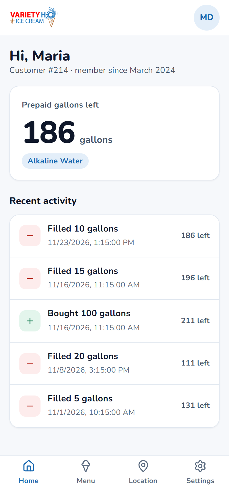
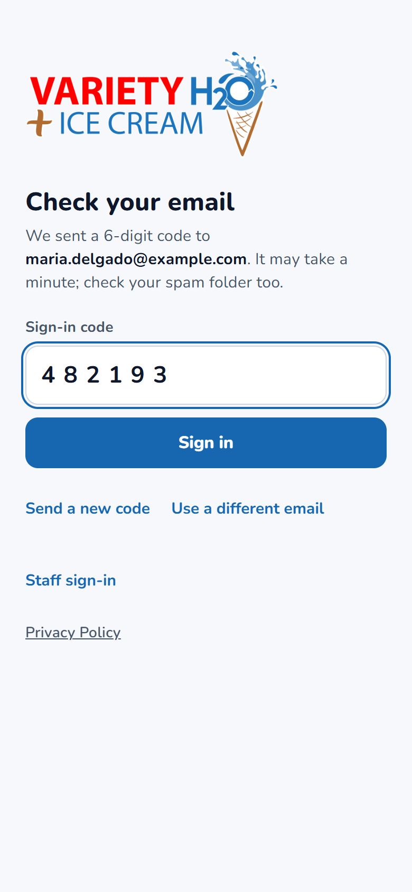
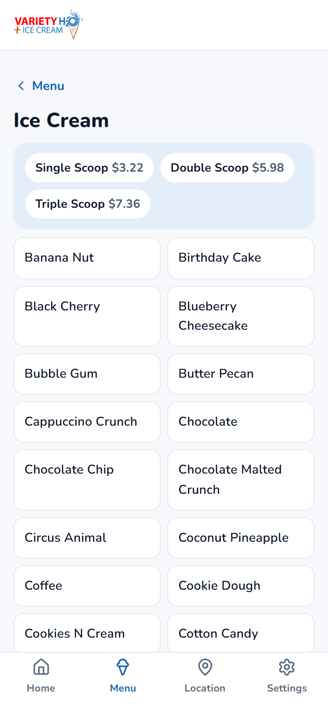
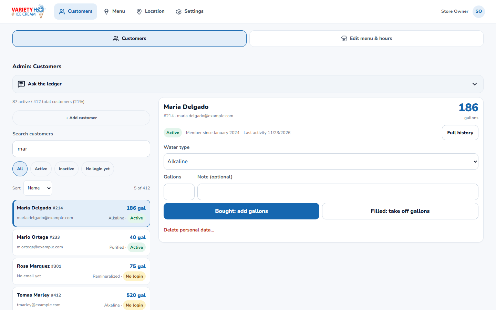
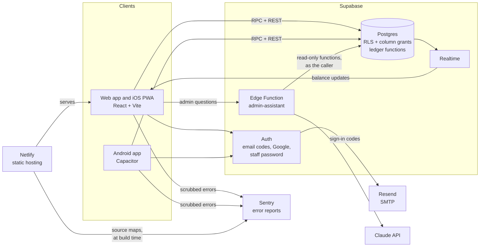
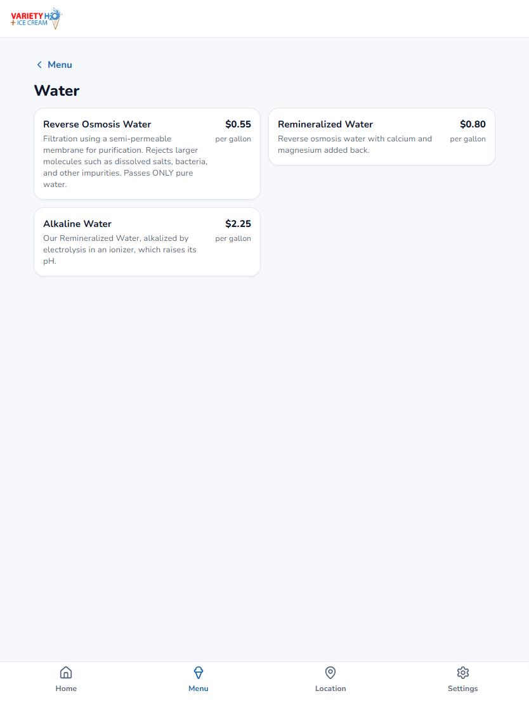
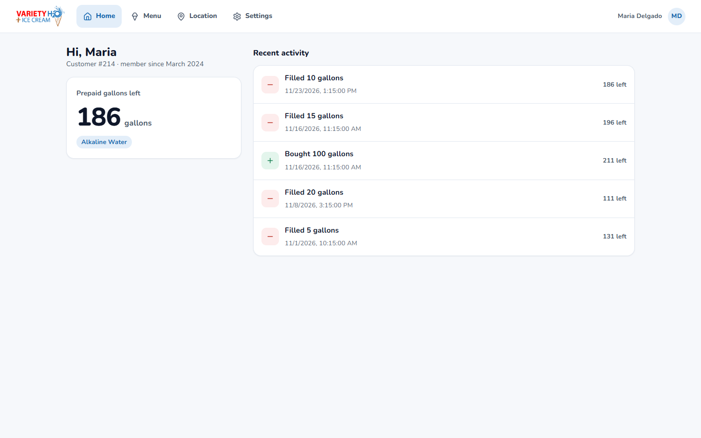

# Variety H2O + Ice Cream

A prepaid-water ledger for a family-owned water and ice cream shop in Tucson, Arizona. Customers
buy gallons of purified water in advance and fill their jugs over time; the app replaced the paper
index card that tracked each customer's balance.

**Live:** [varietyh2o.com](https://varietyh2o.com) · Android on
[Google Play](https://play.google.com/store/apps/details?id=com.varietyh2o.app) · iOS as an
installable web app

<table>
  <tr>
    <td></td>
    <td></td>
    <td></td>
  </tr>
  <tr>
    <td align="center">Customer balance and history</td>
    <td align="center">Passwordless sign-in</td>
    <td align="center">Menu</td>
  </tr>
</table>



*The admin view on desktop. Screenshots use made-up customers.*

## What it does

- **Customers** see their gallon balance and recent fills and purchases, updated live when staff
  ring them up. They sign in with a 6-digit code sent to their email; there are no passwords.
- **Staff** look up a customer, record "Bought" or "Filled", add new customers, and handle
  account-deletion requests. An admin-only assistant answers plain-language questions about the
  ledger ("Who hasn't come in for 60 days?").
- **Everyone** can browse the menu and find the store. The menu, prices, and hours live in the
  database and the owners edit them in the app, with every change logged; offline, the app shows
  the last menu it loaded.
- One codebase serves phones, tablets, and desktops, on the web, as an Android app, and as an
  iOS home-screen app.
- Light by default, dark when the device is: one set of color tokens drives both themes.

About 400 customer records were migrated from the shop's existing list; customers link their own
login on their next visit.

## Architecture



There's no application server. The browser talks to Supabase directly, so the rules that matter
live in the database: row-level security, column-level grants, and a handful of `SECURITY
DEFINER` functions that check who's calling. The only server-side code is one Edge Function for
the assistant. Netlify serves the static build; the Android app wraps the same build with
Capacitor.

## Design decisions

### Balances change only through the ledger
A balance is money the customer has already paid, so no client can set it. Signed-in users,
including the admin, can't update `gallons` at all. Column grants allow writing only
`water_type`. Every change goes through one function, `admin_adjust_gallons()`. It re-checks that
the caller is an admin, locks the customer's row so two registers can't race, refuses to go below
zero, and writes the balance and its ledger row in the same transaction. The ledger and the
balance can't drift apart. A mistake is never edited away: staff record a correction that
reverses it, linked to the original and with a note saying why. `profile_writes.test.sql` and
`ledger.test.sql` try each forbidden write and expect the database to refuse it.

### Passwordless sign-up that links accounts safely
Staff create the customer record with the customer's email. When the customer later signs in
with a code sent to that address, `link_my_profile()` links the login to the record. It does
that only when the email is confirmed **and** the login has no password. Code and Google
sign-ins never set one. A password sign-up made straight through the Auth API might be
auto-confirmed, or planted before the real customer first signs in. Either way, someone else
would know its password. The browser never chooses which record to link.
`signup.test.sql` covers each refusal.

### No browser holds the customer list
Searching happens in the database (`admin_search_customers()`): matching, filtering, sorting, and
a 3-character minimum, with LIKE wildcards escaped. The admin's browser only ever sees the
customers a search matched. Customers load only their own record and their 5 latest entries.

### A read-only AI assistant
"Ask the ledger" runs Claude in a Supabase Edge Function. The API key never reaches the browser.
The model can call only a fixed allowlist of `assistant_*` Postgres functions. They're `STABLE`,
so Postgres rejects any write inside them. They run as the admin's own login, under RLS, never
the service-role key. They never return email addresses. Every answer lists the lookups it used,
so the owners can check where a number came from. `assistant_tools.test.sql` verifies the
functions are read-only and admin-only.

### Error reports that can't identify a customer
Production errors from the website and the Android app go to Sentry, minus anything that could
say whose they were: no user, IP address, cookies, headers, or console output, and every
remaining string is scrubbed of email addresses and URL query strings (Supabase filters live
there). That scrubbing has its own tests. Each report names the commit it came from, so Sentry can
point at the change that likely caused it. Production builds upload source maps for readable stack
traces, then delete them, so the site never serves them. Development, tests, and preview builds
send nothing.

### Layout by window size, not device
Phone, tablet, and desktop layouts come from the actual window size (`useSizeClass()`), not
user-agent sniffing. A resized browser window or an iPad in split view gets the right layout.
Desktop swaps the bottom tab bar for a top bar.

<p>
  
  
</p>

## Testing

- **198 unit and component tests** (Vitest + React Testing Library) against a hand-built fake of
  the Supabase client, so they never touch real data.
- **6 SQL test suites** for what the client can't check: RLS, grants, and the security-sensitive
  functions. Each seeds synthetic data and rolls back.
- **CI on every pull request** (GitHub Actions) runs lint, unit tests, and the build. It also
  builds the database from `schema.sql` twice on plain Postgres, proving it re-runs, then runs
  every SQL suite.
- **Every pull request gets a Netlify Deploy Preview.** Production deploys are manual.
- **Database migrations are checked against live data** inside a transaction that rolls back:
  rehearsed beforehand for larger changes, and verified right after applying for every change.

## Tech stack

React 19, Vite, React Router · Supabase (Postgres, Auth, Realtime, Edge Functions) · Capacitor 8
(Android) · Netlify · Resend · Claude API · Sentry · Vitest, React Testing Library · GitHub Actions

## How it was built

Built in 2026 by Rasesh Kansagra for the family business, working with Claude Code as an AI pair
programmer. Claude Code worked against the live services through MCP servers (Supabase, Netlify,
Sentry) and browser automation, opening each change as a pull request. Every decision involving
customer data, money, or production was the owner's call.
[ROADMAP.md](ROADMAP.md) records each decision and why, including the ones that were tried and
reversed, from replacing the paper cards to the architecture audit that shaped the current design.

## For developers

```bash
npm install
cp .env.example .env   # set VITE_SUPABASE_URL and VITE_SUPABASE_ANON_KEY
npm run dev
```

- [docs/DEVELOPMENT.md](docs/DEVELOPMENT.md): code map, data flow, tests, and conventions.
- [SUPABASE_SETUP.md](SUPABASE_SETUP.md): database, auth, and email setup.
- [ROADMAP.md](ROADMAP.md): what's next and what's been decided.
